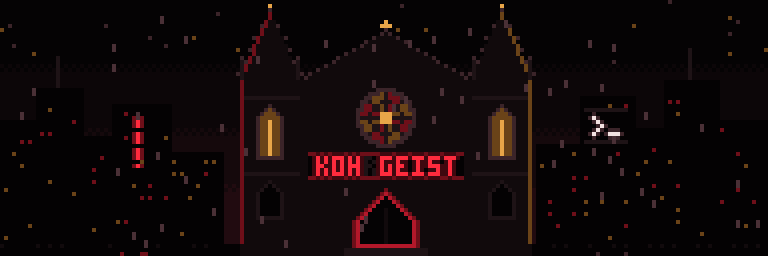

### *In Margine Vivere, In Mente Regnare*

Marcos Pereira · Computer Science @ UNIFEOB · Revenue Operations @ Lider Embalagens · Brazil

 

---

### ⛪ About

I work in Revenue Operations at a packaging manufacturer and ended up building the tools the team runs on: a pipeline that turns messy ERP reports into live dashboards (it replaced a 33-tab spreadsheet), and the tracker we use for our action plans. I like systems that people actually open every day, architecture that holds up, and things that look good while doing it.

### 🗝️ Selected work

| Project | What it is | Built with |
|---|---|---|
| [**painel-fca**](https://github.com/kohrgeist/painel-fca) | Desktop board to run FCA action plans, made for RevOps teams. Works offline, PT-BR / EN, four themes. | Electron · React · Vite · Tailwind |
| [**shenzhen-scrolls-api**](https://github.com/kohrgeist/shenzhen-scrolls-api) | Web-novel platform API where authorization lives outside the code: attribute-based access control (ABAC) decided by Open Policy Agent, with policy tests and a fail-closed gateway. | Node · Express · OPA/Rego · MySQL · Docker |
| [**LiderOps**](https://github.com/sisaque2/LiderOps) | B2B pre-sales hub: ICP prospecting over Brazil's public company registry, CNPJ enrichment, AI-written outreach, task kanban. Team project; I was responsible for the API, authentication, front end and CI. | React · TypeScript · Node · MySQL (AWS RDS) · Gemini |
| [**aeon-assist**](https://github.com/kohrgeist/aeon-assist) | Local, privacy-first meeting transcription: captures mic + system audio natively and transcribes on-device. | C++ (WASAPI) · whisper.cpp · Node · SQLite |
| [**Tsar**](https://github.com/kohrgeist/Tsar) | The long game: an activity tracker meant to grow into a personal AI secretary. Being rebuilt from scratch, by hand. | Python |

### ⚒️ Tools of the trade

<b>🇧🇷 Ler em português</b>

 

**Sobre.** Trabalho com Revenue Operations numa fábrica de embalagens e acabei construindo as ferramentas que o time usa: um pipeline que transforma relatórios bagunçados do ERP em dashboards vivos (substituiu uma planilha de 33 abas) e o painel onde acompanhamos nossos planos de ação. Gosto de sistemas que as pessoas realmente abrem todo dia, de arquitetura que se sustenta e de coisas bonitas fazendo isso.

**Projetos em destaque**
- **painel-fca**: painel desktop para tocar planos de ação FCA, feito para times de RevOps. Funciona offline, em PT-BR e EN, com quatro temas.
- **shenzhen-scrolls-api**: API de uma plataforma de web novels em que a autorização mora fora do código: ABAC decidido pelo Open Policy Agent, com testes das políticas e gateway que nega tudo se o motor de regras cair.
- **LiderOps**: hub de pré-vendas B2B, com garimpo de empresas na base da Receita, enriquecimento de CNPJ, e-mails de prospecção com IA e kanban de tarefas. Projeto em equipe, em que fiquei responsável pela API, autenticação, front-end e CI.
- **aeon-assist**: transcrição de reuniões local, que captura microfone e áudio do sistema e transcreve na própria máquina.
- **Tsar**: o projeto de longo prazo, um monitor de atividade que deve virar um secretário pessoal com IA. Em reconstrução do zero, escrito à mão.

---

Building cathedrals, shipping to the bazaar.

